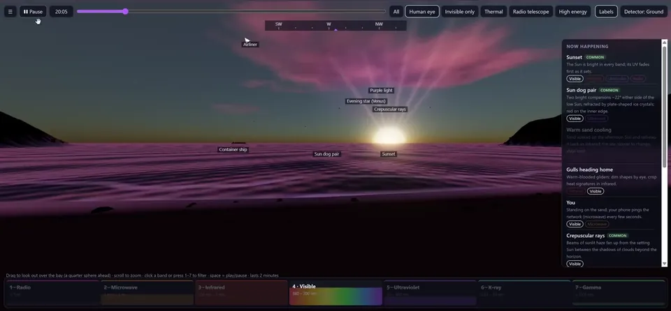

# Spectra Visualizer

[](scenarios/seaside/examples/seaside.mp4)

*The seaside scene from sunset into the night — click for the full 73 s video.*

**See a night sky the way every instrument sees it at once.**

Spectra Visualizer is a set of first-person 3D scenes in the browser. Each one plays a ~90-second timelapse from
sunset into the night, and everything in it — the sky, the landscape, passing aircraft, phones, lighthouses,
cosmic rays, a supernova — emits across the whole electromagnetic spectrum: **radio, microwave, infrared,
visible, ultraviolet, X-ray and gamma**. Switch bands on and off live and watch what your eyes would never show
you: the sea staying warm in infrared after the sand has cooled, Wi-Fi bouncing down a street canyon, a pulsar
sweeping in radio, the air shower of a cosmic ray.

It aims for **physics first, stylisation second**: every glowing thing declares the physical processes behind
it (frequency, wavelength, whether it can reach the ground through the atmosphere), and anything compressed in
time, rare or stylised is labelled as such in the interface.

## Scenes

| Scene | Where you are |
|---|---|
| **Mountain trail** | Walking ~80 m along an alpine trail: a hut, a deer on a thermal camera, cows, fireflies, bats, a campfire, distant hikers' headlamps, a valley cell mast. |
| **Seaside** | On a west-facing beach. The Sun sets into the sea (with a green flash), the sand and the sea swap places in infrared, a lighthouse sweeps the bay, a container ship's radar paints the cliffs, sea mist rolls in. |
| **City** | Out of a street canyon into a park: traffic, pedestrians with phones, Wi-Fi and 5G with multipath reflections, a tram arcing, LiDAR delivery robots, security cameras with near-IR illuminators, fireworks under a light-polluted sky. |

All three share one sky: sunset and twilight, Venus, an airliner, satellites, the Milky Way and the cosmic
microwave background, meteors, a pulsar, a comet, aurora, moonrise and halos, cosmic-ray air showers, a
thunderstorm, a fast radio burst, a supernova and a gamma-ray burst.

## Try it

You need [uv](https://docs.astral.sh/uv/), a browser with WebGL, and a network connection (three.js loads from a
CDN).

```bash
git clone https://github.com/NicoGiamm/spectra_visualizer.git
cd spectra_visualizer
uv run spectra serve        # open http://127.0.0.1:8000 and pick a scene
```

Prefer files you can open straight from disk? `uv run spectra build` writes one self-contained HTML file per
scene to `dist/` (browsers refuse to load the source ES modules over `file://`, the bundled files don't need a
server).

### Controls

| Action | How |
|---|---|
| Look around (a quarter sphere ahead) | drag, or the arrow keys |
| Zoom | scroll |
| Toggle a band | click it, or keys **1–7** (radio → gamma) |
| Band presets | *All*, *Human eye*, *Invisible only*, *Thermal*, *Radio telescope*, *High energy* |
| Play / pause, scrub | **Space**, the time slider |
| Detector | *Orbit* (default: everything drawn) or *Ground* (what is absorbed by the atmosphere is hidden behind a marker that says where and why) |

Hover an event's band chips in the side panel to see its physical processes with frequency and wavelength. With
the Visible band off, the scene turns into a dark detector display where only the selected bands remain.

### Link to a moment

Every scene page accepts URL parameters, handy for sharing a view:

```
?t=30&yaw=0.3&pitch=0.5&bands=ir,micro&detector=ground&paused&labels=0
```

`t` is script time 0–60, `yaw` ±1.35 rad (positive looks left), `pitch` −0.1…1.5 rad, `bands` the bands to keep on.

## How it works

The runtime is plain JavaScript ES modules on [three.js](https://threejs.org/), with no build step. A shared
**engine** provides the band shaders, emitters, sky and atmosphere, HUD and frame loop; each **scenario**
supplies its world and local events and pulls the sky events from a shared library. Python tooling (a
[cyclopts](https://github.com/BrianPugh/cyclopts) CLI run with uv) serves, bundles, screenshots and audits the
scenes.

```
engine/            the runtime shared by every scene
  core/            maths and seeded randomness, shared state, bands and presets, sky geometry,
                   the spectral process table (spectrum.js: every process's frequency / wavelength / energy)
  render/          band shaders, emitters (Em glow, Rib ribbon, EmField instanced crowds),
                   spectral surfaces (temperature, emissivity, albedo per material), instrument view
  world/           atmosphere and the sunset→night timeline, terrain, ray bouncing
  events/          the shared sky/weather event library, the observer (your phone, headlamp)
  ui/              HUD, styles, landing page template
scenarios/<id>/    one folder per scene: index.html, main.js (the scenario), world.js, events.js
src/spectra_tools/ Python tooling: discovery, bundler, dev server, headless screenshots, timeline report
```

Two layers make each band: **sources** (things that glow: a phone, a meteor, a radar sweep) and **surfaces**
(the landscape itself: sand, sea, granite, asphalt and facades each carry a temperature curve, infrared and
microwave emissivity, UV albedo, natural gamma activity and radio reflectivity, so the ground shows the spectrum
too).

### The tooling

```bash
uv run spectra list                   # scenes found under scenarios/
uv run spectra serve                  # dev server + landing page
uv run spectra build [ids…]           # dist/<id>.html single files
uv run spectra shot city -t 54 \
    --bands ir,micro -o city.png      # headless screenshot; exits non-zero on any JS or shader error
uv run spectra timeline city          # event gantt, per-band activity, draw calls, and a physics check
```

Python code is formatted and linted with [ruff](https://docs.astral.sh/ruff/) and type-checked with
[ty](https://docs.astral.sh/ty/): `uv run ruff format . && uv run ruff check . && uv run ty check`.

`spectra timeline` runs a scene headless and checks that every event's declared bands match the physical
processes it lists and the bands it actually draws, in both detector modes. There is no conventional test
suite: the timeline check and headless screenshots are the tests.

### Writing a scene or an event

A scenario is one object:

```js
run({
  title, loading, hint,                       // UI text
  atmosphere: { lightPollution, cloudCover }, // optional
  fog, meterNorm,                             // optional
  build()  { /* add meshes */ return { walk(t, camera), groundAt(x, z), update(t) }; },
  events() { return [sky.sunset(), local.lighthouse(), ...]; },
});
```

An event holds its panel metadata, its physics and its drawing:

```js
event({ name: 'Gulls heading home', t0: 0, t1: 20, bands: ['ir', 'vis'], freq: ['thermal310', 'sunlight'], note: '…',
  init()   { this.e = new Em('ir'); },                  // build once
  update() { this.e.set(pos, size, intensity); },       // every frame; only set() what is visible
  where()  { return this.p; } })                        // label position, or null
```

Event times are on a 0–60 script axis; playback fast-forwards the opening sunset and slows down for the night.
Physical processes (`freq`) are keys of `engine/core/spectrum.js`, where each one carries its frequency or
wavelength and the band is derived from it. To add a scene, copy `scenarios/seaside/`, write its `world.js` and
compose `events()` from the shared library plus your own; the landing page picks it up automatically.

A few conventions keep the scenes consistent: the view always faces west (where the Sun sets), randomness is
seeded so scrubbing replays identically, and glowing things always go through the `Em` / `Rib` / `EmField`
emitters so band filtering and the meters work everywhere.

## License

[MIT](LICENSE) © 2026 NicoGiamm. three.js, loaded from a CDN at runtime, is MIT-licensed too.
